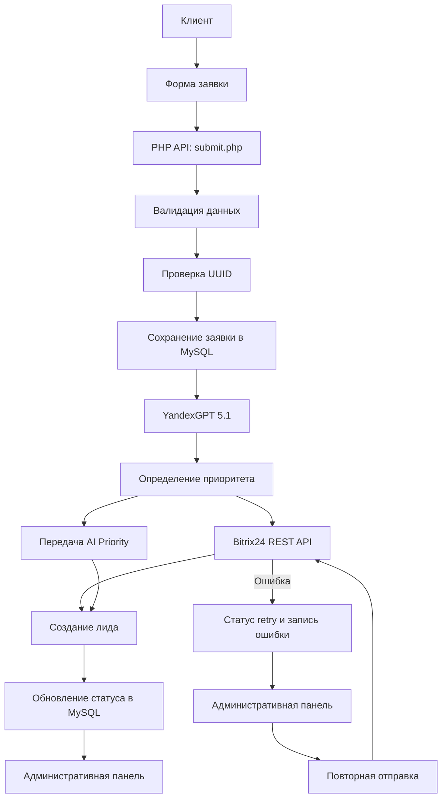

# Lead Management System

Веб-приложение для приёма и обработки клиентских заявок с автоматической классификацией приоритета с помощью YandexGPT 5.1 и интеграцией с Bitrix24 CRM.

## Возможности

- Форма отправки заявок: имя, телефон, email и комментарий.
- Серверная валидация данных.
- Сохранение заявок в MySQL.
- Защита от дублирования заявок с помощью UUID.
- Автоматическая классификация приоритета через YandexGPT:
  - `low` — низкий;
  - `normal` — обычный;
  - `high` — высокий.
- Передача приоритета в пользовательское поле Bitrix24 CRM.
- Отправка заявок в Bitrix24 CRM.
- Сохранение заявок в базе даже при недоступности CRM.
- Повторная отправка неудачных заявок.
- Административная панель с авторизацией.
- Фильтрация заявок по статусам.
- Просмотр приоритетов, ошибок интеграции и количества попыток отправки.

## Технологии

- PHP 8.5
- MySQL
- PDO
- JavaScript (Fetch API)
- Yandex Cloud AI Studio (YandexGPT 5.1)
- Bitrix24 REST API
- HTML / CSS

## Структура проекта

```text
project/
├── database/
│   └── schema.sql
├── includes/
│   ├── admin_auth.php
│   ├── ai.php
│   ├── bitrix.php
│   ├── db.php
│   └── env.php
├── public/
│   ├── api/
│   │   └── submit.php
│   ├── admin/
│   │   ├── index.php
│   │   ├── login.php
│   │   ├── logout.php
│   │   └── retry.php
│   └── index.php
├── .env.example
├── .gitignore
└── README.md
```

## Требования

- PHP 8.0 или выше.
- MySQL 8.0 или совместимая версия.
- PHP extensions:
  - PDO
  - pdo_mysql
  - cURL

## Установка

### 1. Клонирование проекта

```bash
git clone YOUR_REPOSITORY_URL
cd YOUR_PROJECT_FOLDER
```

### 2. Настройка окружения

Создайте `.env` на основе шаблона:

```bash
cp .env.example .env
```

Заполните настройки базы данных, Yandex Cloud AI, Bitrix24 и администратора.

### 3. Создание базы данных

Создайте базу:

```sql
CREATE DATABASE bitrix_leads
CHARACTER SET utf8mb4
COLLATE utf8mb4_unicode_ci;
```

Создайте пользователя MySQL и предоставьте ему необходимые права на эту базу.

Затем выполните SQL-скрипт `database/schema.sql`.

### 4. Запуск приложения

Из корневой директории выполните:

```bash
php -S 127.0.0.1:8000 -t public
```

Откройте приложение:

http://127.0.0.1:8000

## Настройка интеграций

### Yandex Cloud AI Studio

Для классификации заявок используется YandexGPT 5.1 через API Yandex Cloud AI Studio.

В `.env` необходимо указать:

```env
AI_PROVIDER=yandex
YANDEX_API_KEY=your_api_key
YANDEX_FOLDER_ID=your_folder_id
YANDEX_MODEL=gpt://YOUR_FOLDER_ID/yandexgpt-5.1
```

API key должен иметь необходимые права для выполнения запросов к языковым моделям.

Модель анализирует комментарий клиента и определяет приоритет обращения по заданным правилам:

- `low` — общий вопрос или незначительная проблема;
- `normal` — проблема, мешающая работе отдельного пользователя;
- `high` — массовый сбой, недоступность критически важного сервиса, потеря данных или угроза безопасности.

При ошибке AI-интеграции используется значение `normal`.

### Bitrix24 CRM

Для интеграции используется входящий вебхук Bitrix24 с необходимыми правами CRM.

В `.env` добавляется:

```env
BITRIX_WEBHOOK_URL=https://your-domain.bitrix24.ru/rest/USER_ID/WEBHOOK_TOKEN/
```

Для создания лидов используется метод REST API:

`crm.lead.add`

Приоритет передаётся в пользовательское поле лида:

- Название поля: `AI Priority`
- Код поля: `UF_CRM_1794927539`

Соответствие значений приоритета:

| YandexGPT | Bitrix24 |
|---|---|
| `low` | Low |
| `normal` | Normal |
| `high` | High |

Идентификаторы значений списка настраиваются в Bitrix24 и используются при отправке лида.

## Путь данных



## Административная панель

Адрес:

http://127.0.0.1:8000/admin/

Доступ осуществляется по логину и паролю, заданным в `.env`.

Для хранения пароля используется хеш, созданный функцией PHP `password_hash()`.

В панели доступны:

- просмотр заявок;
- фильтрация по статусам;
- просмотр приоритетов;
- просмотр ошибок отправки;
- повторная отправка заявок в Bitrix24;
- выход из аккаунта.

## Обработка ошибок

Заявка сначала сохраняется в MySQL.

Если отправка в Bitrix24 завершается ошибкой:

- заявка остаётся в базе;
- статус меняется на `retry`;
- сохраняется описание ошибки;
- увеличивается счётчик попыток;
- устанавливается время следующей попытки.

Повторная отправка доступна из административной панели.

## Безопасность

- Секретные данные хранятся в `.env`.
- `.env` исключён из Git.
- Для SQL-запросов используется PDO и подготовленные выражения.
- Данные формы проходят серверную валидацию.
- Административная панель защищена сессиями.
- Для повторной отправки используется CSRF-токен.
- Пользовательские данные экранируются при выводе в HTML.